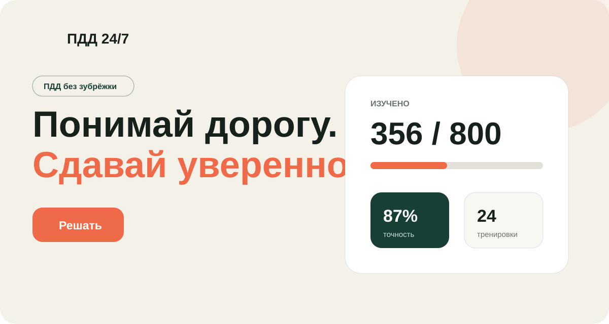

# ПДД 24/7


Тренажёр теоретического экзамена ПДД РФ для категорий A, B и M. Он помогает регулярно практиковаться, разбирать ошибки и видеть реальный прогресс.



## Возможности

- **Решать** — 20 вопросов из четырёх официальных тематических групп без ограничения времени.
- **Экзамен** — 20 минут, дополнительные блоки за ошибки и серверная проверка результата.
- **Марафон** — последовательное прохождение всей базы из 800 вопросов.
- **Билеты** — каждый из 40 классических билетов отдельно.
- **Вопросы** — практика выбранных номеров вопросов во всех билетах.
- **Статистика** — точность, изученные вопросы, история прохождений и сложные темы.

В тренировочных режимах приложение сразу показывает правильный вариант и объяснение, а после правильного ответа автоматически переводит к следующему вопросу. Состояние сохраняется между перезагрузками без регистрации — по анонимному UUID посетителя.

Светлая и тёмная темы переключаются вручную и запоминаются в браузере.

## Быстрый запуск

На компьютере нужны только Docker с Compose и `make`:

```bash
make init
```

Приложение будет доступно на [http://localhost:8088](http://localhost:8088).

```bash
make up       # запустить контейнер
make down     # остановить контейнер
make logs     # открыть поток логов
make shell    # открыть shell приложения
make lint     # отформатировать PHP через Laravel Pint
make import   # повторно импортировать вопросы
make help     # показать все команды
```

SQLite, конфигурация, изображения вопросов и runtime-данные хранятся в именованных Docker volumes. Обычный `make down` их не удаляет.

## Для разработчиков

- PHP 8.5 и Laravel 12;
- Inertia.js и Vue 3 Composition API;
- TypeScript, Tailwind CSS 4 и Vite;
- SQLite с foreign keys и WAL mode;
- Laravel Pint для единого стиля PHP.

Основная логика разделена по сервисам:

- `QuestionImportService` проверяет и импортирует датасет;
- `QuestionSelectionService` собирает тематические наборы;
- `PracticeSessionService` создаёт и восстанавливает сессии;
- `AnswerSubmissionService` атомарно фиксирует ответы;
- `ExamEngine` определяет этап и результат экзамена;
- `StatisticsService` агрегирует прогресс пользователя.

Правильные ответы экзамена не передаются клиенту до завершения. Время хранится абсолютным серверным timestamp. Повторная отправка одного ответа не меняет результат.

### Запуск без Docker

```bash
composer install
cp .env.example .env
touch database/database.sqlite
php artisan key:generate
php artisan migrate
npm install
npm run build
php artisan serve
```

## Вопросы и изображения

Используется набор [etspring/pdd_russia](https://github.com/etspring/pdd_russia): 40 билетов категорий A/B, по 20 вопросов в каждом. Команда импорта проверяет количество билетов и вопросов, единственный правильный ответ и наличие изображений:

```bash
php artisan pdd:import
```

Повторный импорт обновляет вопросы, не удаляя пользовательскую статистику.

В исходном репозитории не обнаружена явная лицензия. Перед публичным или коммерческим запуском необходимо получить разрешение правообладателей либо заменить материалы источником с подходящей лицензией. Актуальность вопросов также требует отдельной редакционной проверки.

## Правила экзамена

Движок основан на пунктах 124 и 130–139 [приказа МВД России от 20.02.2021 № 80](https://www.consultant.ru/document/cons_doc_LAW_380236/): четыре тематических блока, 20 основных вопросов, 20 минут и дополнительные вопросы из групп, в которых допущены ошибки.

В учебном интерфейсе прохождение не прерывается сразу после достижения лимита ошибок: пользователь может закончить все выданные вопросы. Итог показывается после завершения набора либо по истечении времени.
